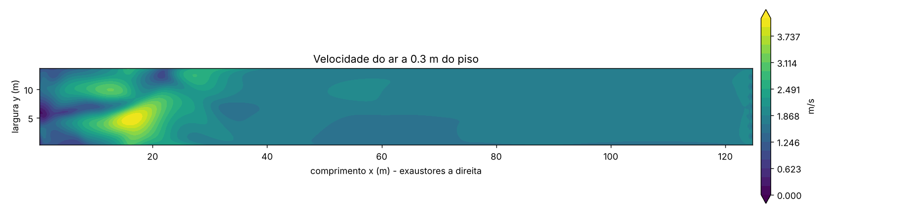
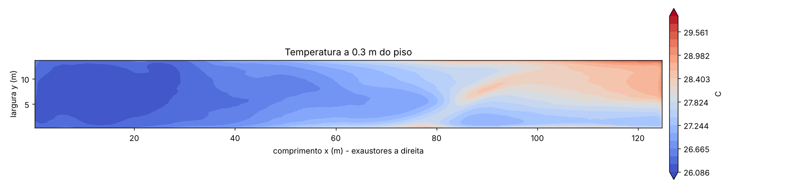
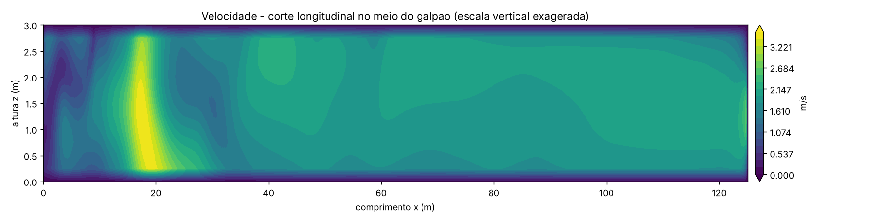
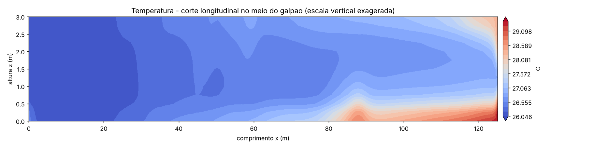

# Resultado da simulacao: aviario_8_exaustores

Iteracao final: 1500  |  celula 0.25 m  |  8 exaustores de 35000 m3/h

## Na altura dos animais (0.3 m)

| Indicador | Valor |
|---|---|
| Velocidade media do ar | 1.87 m/s |
| Velocidade minima / maxima | 0.09 / 4.15 m/s |
| Area com velocidade abaixo de 2.00 m/s (80% do alvo 2.5) | 84 % |
| Area com velocidade abaixo de 0,5 m/s (ar parado) | 0 % |
| Temperatura media | 27.1 C |
| Temperatura maxima | 29.9 C |
| Temperatura de entrada | 26.0 C |

## Balanco

- Vazao total nos exaustores: 278,670 m3/h (89.8 kg/s)
- Erro de conservacao de massa: 0.00 % (bom se < 1 %)
- Temperatura media do ar saindo pelos exaustores: 27.43 C

## Ao longo do galpao (faixas de 10 m)

| Trecho (m) | Vel. media (m/s) | Vel. minima (m/s) | Temp. media (C) |
|---|---|---|---|
| 0-10 | 1.57 | 0.09 | 26.2 |
| 10-20 | 2.69 | 1.10 | 26.2 |
| 20-30 | 2.26 | 0.91 | 26.3 |
| 30-40 | 1.84 | 1.48 | 26.5 |
| 40-50 | 1.74 | 1.63 | 26.7 |
| 50-60 | 1.74 | 1.47 | 26.9 |
| 60-70 | 1.71 | 1.47 | 27.1 |
| 70-80 | 1.74 | 1.55 | 27.4 |
| 80-90 | 1.77 | 1.55 | 27.7 |
| 90-100 | 1.77 | 1.42 | 27.8 |
| 100-110 | 1.78 | 1.40 | 28.0 |
| 110-120 | 1.79 | 1.42 | 28.2 |
| 120-125 | 1.83 | 1.17 | 28.3 |

## Mapas

